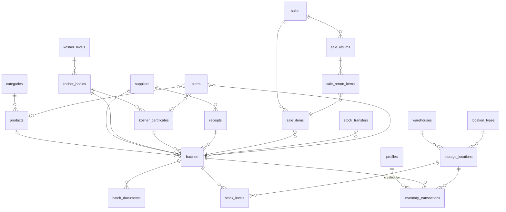

# MEAT STOCK – מסמך תכנון

מערכת פנימית לניהול חנות מפעל בשר. משתמשת בה הקופה / ההנהלה בלבד – לקוחות לא רואים אותה.
כל רשימה (קטגוריות, הכשרים, ספקים, מחסנים, מקררים, סוגי מיקום, רמות כשרות...) מנוהלת על-ידי המשתמש דרך "+ הוסף". אין ערכים קבועים בקוד.

## 1. ארכיטקטורה

```
דפדפן (מחשב קופה / טאבלט / טלפון)
  Next.js 16 App Router · React 19 · Tailwind 4 · shadcn/ui (RTL) · RHF + Zod · Recharts
        │  HTTPS + cookie session (@supabase/ssr)
שרת Next.js
  • קריאה: Server Components (תמיד דינמי – cacheComponents כבוי)
  • כתיבה: Server Actions → Zod → supabase.rpc(...) / insert תחת RLS
  • מפתח service_role – בשרת בלבד, רק ליצירת משתמשים
        │
Supabase
  • Auth – משתמשי עובדים (ללא הרשמה עצמית)
  • Postgres – טבלאות + RLS לפי תפקיד + פונקציות מלאי (SECURITY DEFINER, טרנזקציה אחת כל אחת)
  • pg_cron – generate_alerts() כל שעה
  • Storage – bucket פרטי `documents` (תעודות), `product-images`
GitHub Actions – pg_dump לילי (גיבוי)
```

### כללי אמינות
| כלל | מימוש |
|---|---|
| אין מלאי שלילי | `CHECK (qty_kg >= 0 AND packages >= 0)` על `stock_levels` + בדיקה מפורשת בפונקציות |
| אין חריגה במקביל | `SELECT … FOR UPDATE` על שורות המלאי, בסדר קבוע (מונע deadlock) |
| אין מכירה כפולה | `sales.idempotency_key UNIQUE`; קריאה חוזרת עם אותו מפתח מחזירה את המכירה הקיימת |
| תנועות לא נמחקות | טריגר שחוסם UPDATE/DELETE על `inventory_transactions`; אין הרשאת כתיבה ישירה |
| כמויות משתנות רק דרך פונקציות | אין מדיניות INSERT/UPDATE ל-`stock_levels` – רק פונקציות SECURITY DEFINER |
| אצוות לא מתאחדות | כל שורת קבלה = אצווה חדשה; `expiry_date` ו-`kosher_body_id` לא ניתנים לשינוי אחרי יצירה (טריגר) |
| ביטול | `reverse_transaction` / `cancel_sale` / `return_sale_items` יוצרים תנועות נגדיות מקושרות |
| יומן פעולות | טריגר `audit_row()` על טבלאות ניהול → `audit_log` |

## 2. תרשים טבלאות



### טבלאות עיקריות
- `profiles` (id=auth.users.id, full_name, role `app_role`, is_active)
- `app_settings` (שורה יחידה: store_name, expiry_alert_days int[] = {14,7,3}, default_min_stock_kg)
- `categories`, `location_types`, `kosher_levels(rank)`, `kosher_bodies(level_id)`
- `kosher_certificates` (kosher_body_id, supplier_id?, certificate_number, valid_from, valid_until, document_path)
- `suppliers` (kind: supplier|factory, contact, phone, email, address)
- `warehouses`, `storage_locations` (warehouse_id, name, code, location_type_id, zone, shelf, temp_min, temp_max)
- `products` (name, sku UNIQUE, barcode UNIQUE?, category_id, description, image_path, sale_price_per_kg, cost_price_per_kg, min_stock_kg, is_active)
- `receipts` (קבלת סחורה – כותרת: supplier, delivery_note, received_at)
- `batches` (batch_number UNIQUE, product, supplier, kosher_body, kosher_certificate?, receipt?, production_date, received_date, expiry_date, initial_qty_kg, initial_packages, cost_price_per_kg)
- `stock_levels` PK(batch_id, location_id): qty_kg numeric(12,3), packages int – **המלאי בפועל**
- `inventory_transactions` (append-only): txn_type, batch, location, qty_kg_delta, packages_delta, ref_type/ref_id, reverses_txn_id, reason, created_by, created_at
- `sales` (sale_number, idempotency_key UNIQUE, kosher_body_ids uuid[], subtotal, discount, total, status completed|cancelled), `sale_items` (batch, location, qty_kg, packages, price_per_kg, cost_per_kg snapshot, discount, line_total)
- `sale_returns` + `sale_return_items` (restock → מיקום, או השמדה)
- `stock_transfers` (batch, from_location, to_location, qty_kg, packages)
- `alerts` (type, batch?/product?/certificate?, severity, message, dedupe_key UNIQUE, status open|acknowledged|resolved)
- `audit_log`

### כשירות אצווה למכירה
אצווה כשירה אם: `expiry_date >= היום`, ואם יש לה תעודת הכשר – `valid_until >= היום`, ואם במכירה נבחרו גופי הכשר – `kosher_body_id ∈ kosher_body_ids`.
FEFO: מיון לפי `expiry_date`, ואז `received_date`.

## 3. הרשאות

| פעולה | admin | store_manager | warehouse_worker | sales_employee | viewer |
|---|---|---|---|---|---|
| צפייה בכל הנתונים | ✓ | ✓ | ✓ | ✓ | ✓ |
| ניהול מוצרים/קטגוריות/ספקים/הכשרים/מקררים | ✓ | ✓ | – | – | – |
| קבלת סחורה, העברות, התאמות מלאי | ✓ | ✓ | ✓ | – | – |
| מכירה | ✓ | ✓ | – | ✓ | – |
| ביטול מכירה / החזרה / ביטול תנועה | ✓ | ✓ | – | – | – |
| משתמשים והגדרות | ✓ | – | – | – | – |

נאכף ב-RLS (`has_role(...)`) ובתוך כל פונקציית RPC, וגם ב-Server Actions.

## 4. מבנה תיקיות

```
meat-stock/
  src/app/(auth)/login            מסך התחברות
  src/app/(app)/…                 כל המודולים (layout עם סרגל צד)
  src/components/ui               shadcn
  src/components/shell            סרגל צד, כותרת עליונה
  src/components/data-table       טבלה עם חיפוש, סינון ומיון
  src/features/<module>/          schema.ts (Zod) · actions.ts · queries.ts · components/
  src/lib/supabase                client/server/admin/proxy
  src/lib/auth.ts                 getCurrentUser / requireRole
  src/lib/errors.ts               תרגום שגיאות DB לעברית
  src/types/database.ts           טיפוסים מ-supabase gen types
  supabase/migrations             סכמה, RLS, פונקציות, cron
  supabase/seed.sql               נתוני פיתוח בלבד (לא נטען בפרודקשן)
  tests/unit · tests/integration · e2e
  .github/workflows               ci.yml · backup.yml
```

## 5. תוכנית עבודה
| שלב | תוכן | בדיקה |
|---|---|---|
| א | פרויקט, תלויות, shadcn RTL, Supabase מקומי, ENV | build + lint |
| ב | כל הטבלאות, קשרים, אינדקסים, RLS, פונקציות מלאי, cron | בדיקות אינטגרציה SQL/RPC |
| ג | התחברות, proxy, תפקידים, ניהול משתמשים | בדיקות RLS לפי תפקיד |
| ד | מוצרים, קטגוריות, ספקים, הכשרים, מחסנים, מקררים, אצוות | build + e2e בסיסי |
| ה | קבלת סחורה, מלאי, העברות, התאמות, יומן תנועות | בדיקות מלאי שלילי / ביטול |
| ו | מסך מכירה (FEFO, הכשר, הנחה), ביטול והחזרה | מכירה מקבילה, idempotency |
| ז | התראות (pg_cron) + מסך התראות | generate_alerts |
| ח | דוחות + Excel + PDF (הדפסה) + דשבורד | |
| ט | CI, גיבוי, הקשחה, README, פריסה | הכול |
